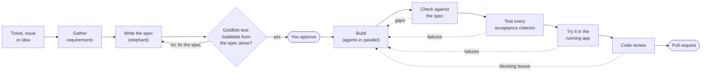

# spec2pr

**Give Claude Code a ticket. Get back a reviewed, tested pull request, and watch every step of the way.**

spec2pr is a free plugin for [Claude Code](https://claude.com/claude-code). You hand it a Jira ticket,
a GitHub issue or a one-line idea. It writes a spec, makes sure the spec is clear enough to build from,
builds the feature with a team of AI agents, tests it, opens the real app to check it works, reviews the
code, and opens the pull request. It stops and asks you whenever a decision is yours to make.

**[Website](https://paulpriyam.github.io/spec2pr/)** · [Install](#install) · [How it works](#how-it-works) · [The dashboard](#the-dashboard)


## Why

AI coding agents are fast, but on real features they tend to drift: they guess when the requirements
are vague, mark their own homework, and lose track of decisions made an hour ago. spec2pr fixes that
with one simple idea.

- **One agent remembers everything.** We call it the *elephant*. It talks to you, writes the spec and
  keeps every decision in it. It never writes code itself.
- **Every other agent starts fresh.** We call them *goldfish*. Each one gets only the spec and the files
  it needs, nothing else. If a goldfish can't build from the spec alone, the spec isn't good enough yet,
  so it gets fixed *before* any code is written.
- **Nobody checks their own work.** Code is checked against the spec, tested, tried out in the running
  app and reviewed, each time by an agent that never saw how it was written.

## Install

You need [Claude Code](https://claude.com/claude-code), `git`, `python3`, `node`, `jq`, and the
[GitHub CLI](https://cli.github.com) (`gh auth login`).

```bash
claude plugin marketplace add paulpriyam/spec2pr
claude plugin install spec2pr@spec2pr
```

Restart Claude Code. spec2pr writes its specs with [spec-kit](https://github.com/github/spec-kit),
so set that up once per machine and once per project:

```bash
uv tool install specify-cli --from git+https://github.com/github/spec-kit.git   # once per machine
specify init --here --ai claude                                                 # once per project
```

## Your first feature

Open Claude Code in your project and type one of these:

```text
/ship-feature PROJ-123                                   a Jira ticket
/ship-feature #42                                        a GitHub issue
/ship-feature saved-cards "Let users save their cards"   just an idea
```

The dashboard opens in your browser. From there:

1. spec2pr reads the ticket and any linked docs or designs, and asks you about anything unclear.
2. It writes the spec and tests it on a goldfish. You'll see a **Needs you** card: read the plan and
   press **Go**.
3. It builds, tests, checks the app and reviews, fixing what fails along the way.
4. It opens the pull request. Merging it is up to you.

Already halfway through something? Run **`/verify-feature`**. It checks what you have so far in the
running app, shows you what works and what doesn't, and asks whether to finish it, ship it, or stop.

## How it works



Every arrow back to **Build** is capped, so a stuck feature stops and asks you instead of looping
forever. Nothing can be committed or pushed until the spec check, the tests, the app check and the review
have all passed.

Each feature is built in **its own copy of your repo** (a git worktree), so your main checkout stays
untouched and you can run several features at once, one Claude Code session each.

## The dashboard

Everything happens on a local page at `http://127.0.0.1:7788`. It opens by itself; `/feature-dashboard`
brings it back. After you update the plugin, the open dashboard switches to the new version by itself
within a few seconds; Claude Code sessions started before the update can't swap it back to an older one.

It comes in an 8-bit **Arcade** look, designed so the thing that needs you is the thing you notice:
a pixel goldfish logo, a quiet digital rain behind solid panels, and green-on-black terminal text.
Only the **Needs you** label blinks; its card glows slowly with a gold "Pick a choice" hint. The stage
that's running is lit up, and loop counters read like a scoreboard (`01/03`), with "lives" showing how
many fix rounds are left. Prefer something plainer? The **Arcade / Classic** switch in the top bar flips
to the original look and remembers your choice. Animations stop if your system is set to reduce motion.

**Pipeline:** where each feature is, what's being done right now, and every check's result.
Every project you use spec2pr in is listed on the left.


**Live flow:** what the agents are doing, as it happens. A flow map at the top shows every step as a
graph: agents working in parallel stacked side by side, the one running now pulsing, and red dashed lines
where work was sent back for fixes. Click any step to see its tool calls in the list below.


**Needs you:** when a decision is yours, you get a desktop notification and a card with buttons. Answer
there or in the terminal, whichever is closer.


**Away from your desk?** Connect Telegram once with `/telegram-setup` and the same questions arrive
on your phone with a button per choice. Tap one, or reply with a note ("Change the spec: Visa only"),
and the feature carries on. You also get a message when an agent looks stuck in a loop and when the
pull request is opened.

**Checked in the real app:** for every acceptance criterion, a pass or fail with a screenshot as proof.


## It learns from every feature

When a feature finishes, spec2pr writes down what had to be sent back for fixes and why (for example
"app check: the declined-payment screen was missing"). When the same kind of problem shows up in a
second feature, it turns it into a short **lesson**, such as "build and test every error state the
spec lists", and hands it to the right agents at the start of every later feature. Each lesson keeps
a scorecard: if the problem keeps coming back anyway, spec2pr rewrites the lesson.

- **Lessons about this repo** (from repeated problems, your corrections and PR review comments) live in
  `.spec2pr/lessons.md` in the project. Commit it and your team shares them.
- **Lessons for every project** live in `~/.spec2pr/lessons.md`. spec2pr asks you before adding one.
- The dashboard's **Learning** tab shows the fixes-per-feature trend, the most common problems, and every
  lesson with an on/off switch. Both files are plain Markdown you can edit.


- Lessons are never given to the goldfish test, which must judge the spec on its own, and the spec
  always wins over a lesson.

## Checking the real app

After the tests pass, an agent opens your app and goes through each acceptance criterion the way a user
would, taking screenshots as it goes. It works with:

| What you build | How it's checked |
|---|---|
| Websites and web apps | [Playwright](https://playwright.dev) in a real browser |
| Chrome extensions | Playwright, with your extension loaded |
| Android apps | [Maestro](https://maestro.mobile.dev) on the Android emulator |
| iOS apps | Maestro on the Xcode simulator |

All of these are free and run on your machine. The first time a feature needs one, spec2pr asks if it
may install it. Android needs Android Studio with an emulator, and iOS needs Xcode.

## Commands

| Command | What it does |
|---|---|
| `/ship-feature <ticket or name>` | Take a feature from start to pull request |
| `/verify-feature` | Check work in progress in the running app, then decide what's next |
| `/feature-dashboard` | Open the dashboard |
| `/feature-status` | A quick text summary of where a feature is |
| `/telegram-setup` | Answer questions from your phone: connect your own Telegram bot (one minute) |
| `/goldfish-check <file>` | Test any spec or design doc: could someone build from it alone? |

## Good to know

- **Your code stays local.** The dashboard runs only on your machine (`127.0.0.1`). Pipeline progress is
  kept in a git-ignored `.agent-state/` folder in each project. Passwords and tokens are blanked out of
  anything it records.
- **Jira and GitHub are optional.** With a Jira ticket or a GitHub issue, spec2pr posts short progress
  updates. With a plain idea, no ticket system is involved. For Jira, Confluence or Figma, connect those
  connectors in Claude Code.
- **Telegram is optional and private to you.** You make your own bot with @BotFather, so messages go
  only between it and you; replies from anyone else are ignored. The token is stored in
  `~/.spec2pr/telegram.json`, readable only by you. Claude Code has to stay open on your laptop (and the
  laptop awake) for the feature to keep going. `FF_TELEGRAM=off` pauses it.
- **It never merges.** Merging the pull request is always your call.
- **It warns you about loops.** If an agent runs the same failing command three times, or a builder makes 25
  tool calls without changing a file, the feature is marked **Looping?** on the dashboard and you get a
  desktop notification, so you can step in early.
- **It shows tokens used and estimated cost.** Every feature, and every agent in the live flow, shows the tokens
  it used (hover for input, output, cache writes and cache reads) and an estimated cost worked out from
  those counts at Claude API list prices. On a Claude subscription you aren't
  billed per token, so read it as "what this would cost on the API". Prices can be changed in
  `~/.spec2pr/prices.json`.

## Reference

<details>
<summary><b>All <code>/ship-feature</code> options</b></summary>

```text
/ship-feature PROJ-123                                  Jira ticket
/ship-feature #42                                       GitHub issue
/ship-feature saved-cards "description"                 your own idea
/ship-feature saved-cards --doc notes/cards.md          requirements in a file
/ship-feature saved-cards --spec specs/012-saved-cards  use spec docs that already exist
/ship-feature saved-cards --adopt                       work already in progress: write the spec from the code
```

| Option | Effect |
|---|---|
| `--from goldfish\|implement\|guardian\|verify\|reviewer` | Start from a later stage |
| `--fast` | Skip the goldfish test |
| `--base <branch>` | Branch to build on and compare against (default: the repo's default branch) |
| `--here` | Work in your current checkout instead of a separate worktree |
| `--no-dashboard` | Don't open the dashboard |

`/verify-feature` takes `--url http://localhost:3000` to check an app you already have running, and
`--platform web|extension|android|ios` to choose what to check.
</details>

<details>
<summary><b>Worktrees: one copy of the repo per feature</b></summary>

New features are built in `<repo>/.ff-worktrees/<name>` on branch `ff/<name>`. Your untracked `.env`
files are copied in and dependencies are installed automatically (pnpm, yarn, bun, npm, uv or poetry).
Put a `.ff-setup` script in the repo root to set up a worktree your own way, or set
`FF_WORKTREE_SETUP=none` to skip setup. When a feature is done you're asked whether to remove its
worktree; the branch is kept.

Tools that scan the whole repo, such as a root-level `tsc` or jest without `roots`, may also pick up
`.ff-worktrees/`. Exclude that folder in their config.
</details>

<details>
<summary><b>App check setup by hand</b></summary>

From the plugin folder (`~/.claude/plugins/cache/spec2pr/spec2pr/<version>`):

```bash
scripts/verify-env.sh check                          # what's ready on this machine
scripts/verify-env.sh setup web                      # Playwright + Chromium (also covers Chrome extensions)
scripts/verify-env.sh setup android                  # Maestro, using Android Studio's Java if present
scripts/verify-env.sh setup ios                      # Maestro for the Xcode simulator
```

Maestro needs Java 17 or newer. Setup uses Android Studio's bundled Java when it finds it; otherwise it
downloads Eclipse Temurin 17 into `~/.spec2pr/jdk`. No Homebrew or admin rights are needed.
</details>

<details>
<summary><b>Settings and status line</b></summary>

| Setting | Effect |
|---|---|
| `FF_DASHBOARD=off` | Never open the dashboard |
| `FF_DASHBOARD_PORT=7788` | Dashboard port |
| `FF_NOTIFY=off` | No desktop notifications |
| `FF_TELEGRAM=off` | Don't send questions to Telegram (stays connected) |
| `FF_WORKTREE_SETUP="<command>"` or `none` | How a new worktree is set up |

Clickable notifications on macOS: `brew install terminal-notifier`.

Status line showing the current feature and phase, in `~/.claude/settings.json`:

```json
{ "statusLine": { "type": "command", "command": "~/.claude/plugins/cache/spec2pr/spec2pr/<version>/scripts/statusline.sh" } }
```

The dashboard lists projects from `~/.spec2pr/repos.txt`; delete a line there to drop a project.
</details>

<details>
<summary><b>Customising</b></summary>

- **Models:** the `model:` line at the top of each file in `agents/` (`opus`, `sonnet` or `haiku`).
- **Jira status names:** the transitions in `commands/ship-feature.md`.
- **Retry limits and the `--fast` rule:** `commands/ship-feature.md`.
- **Jira tools:** `context-analyst` and `jira-sync` list tools for both the claude.ai Atlassian connector
  and a local `atlassian` MCP server; remove the one you don't use.

The commit gate catches skipped steps; it isn't a security boundary.
</details>

<details>
<summary><b>What's in this repo</b></summary>

| Path | What |
|---|---|
| `commands/` | The slash commands. `ship-feature.md` is the elephant's playbook. |
| `agents/` | context-analyst, goldfish-spec-test, implementer, spec-guardian, tester, app-verifier, pr-reviewer, pr-shepherd, jira-sync |
| `hooks/hooks.json` | Commit gate, activity log, dashboard auto-open |
| `dashboard/` | The local dashboard (Python standard library only) |
| `scripts/` | Worktrees, questions, Telegram, learning (`learn.py`), app-check setup, status line |
| `docs/` | The website and the images in this README |
</details>

## Updating

```bash
claude plugin marketplace update spec2pr && claude plugin update spec2pr@spec2pr
```

Then restart Claude Code.

## Contributing

Issues and pull requests are welcome. If you change the plugin, raise `version` in
`.claude-plugin/plugin.json`, because Claude Code only picks up new versions.

## License

[MIT](LICENSE)
